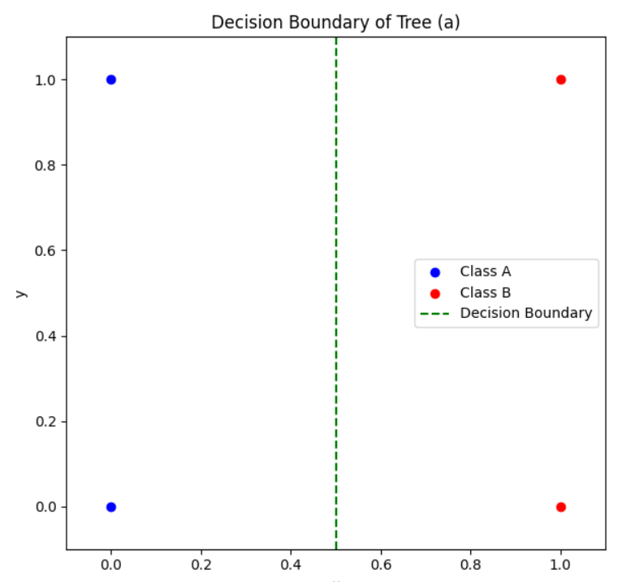
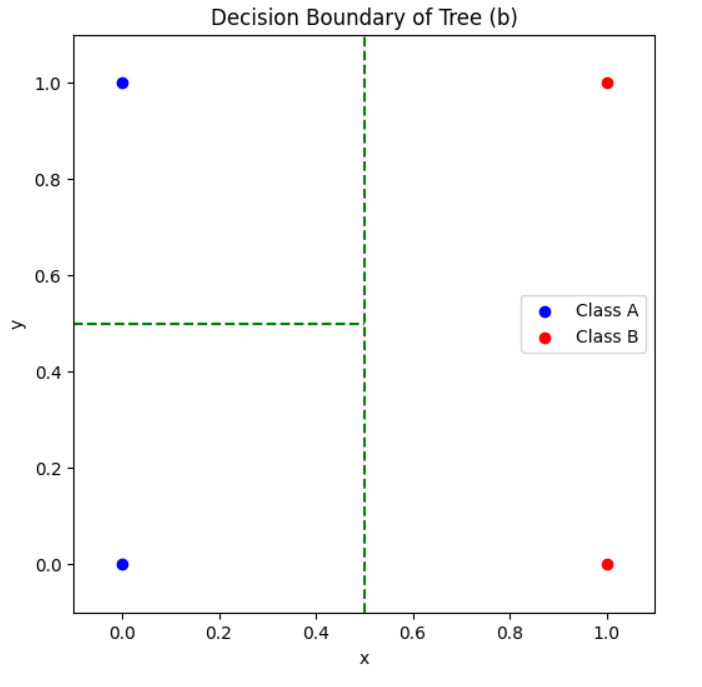
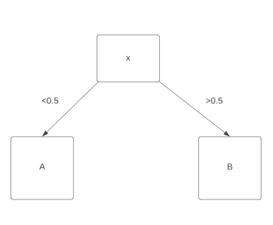

# Decision Tree Boundaries


A visual analysis of decision boundaries for two decision trees classifying
two-dimensional data into Class A and Class B, and an accuracy comparison
between them. The data are four points at the corners of the unit square —
`(0, 0)`, `(0, 1)`, `(1, 0)`, and `(1, 1)`.

## Key Results

- **Tree (a) — single split on `x`:** misclassifies **all 4** data points
  (0 of 4 correct).
- **Tree (b) — splits on `x`, then on `y`:** misclassifies **3 of 4** data
  points; only `(0, 0)` is classified correctly (1 of 4 correct).
- **Both trees perform equally in accuracy**, so the simpler model wins:
  Tree (a) is preferred on grounds of simplicity.
- **Swapping the class labels** — Class A where `x < 0.5`, Class B where
  `x ≥ 0.5` — makes the single-split tree classify **all 4 data points
  correctly**.

## The two trees

**Tree (a) — a single split on x**

- Split: `x < 0.5` → Class B; otherwise Class A.
- The decision boundary is a single vertical line at `x = 0.5`. The feature
  `y` plays no role in this tree.



*Figure 1 — Decision boundary of Tree (a): one vertical dashed line at
`x = 0.5`. The two blue points on the left are Class A and the two red
points on the right are Class B, so every point falls on the wrong side.*

**Tree (b) — splits on x, then on y**

- First split: `x < 0.5`. Inside that branch, a second split: `y < 0.5`.
- The boundary is a vertical dashed line at `x = 0.5` plus a horizontal
  dashed line at `y = 0.5` that applies only where `x < 0.5`.
- Regions:
  - `x ≥ 0.5` → Class A
  - `x < 0.5` and `y ≥ 0.5` → Class B
  - `x < 0.5` and `y < 0.5` → Class A



*Figure 2 — Decision boundary of Tree (b): the extra horizontal split at
`y = 0.5` (for `x < 0.5` only) still leaves 3 of the 4 points misclassified.*

## Accuracy comparison

Neither tree as drawn classifies the data correctly:

- Tree (a) misclassifies every data point, because it relies on a single
  boundary on `x` alone.
- Tree (b) adds complexity by considering both `x` and `y`, yet still
  misclassifies every point except `(0, 0)`.

Both trees therefore perform equally in accuracy, so the simpler model wins:
Tree (a) is preferred on grounds of simplicity. When two models perform
equally, choose the simpler one.

## Fixing the labels

Swapping the class labels — assigning Class A where `x < 0.5` and Class B
where `x ≥ 0.5` — makes the single-split tree classify all data points
correctly. The report includes a diagram of the corrected boundary.



*Figure 3 — The corrected tree: with the labels swapped, the single split
on `x` classifies all four points correctly.*

## How to Run

There is no code to install — the analysis is in the report, and the figures
are in `images/`.

1. Open `report/Decision_Tree_Boundaries.pdf` for the full write-up with the
   boundary plots.
2. To recreate the plots, plot the four points `(0, 0)`, `(0, 1)`, `(1, 0)`,
   and `(1, 1)` with Python and Matplotlib (`pip install matplotlib`), draw
   a vertical dashed line at `x = 0.5` for Tree (a), and add a horizontal
   dashed line at `y = 0.5` for `x < 0.5` for Tree (b).

## Files

```
├── README.md
├── LICENSE
├── images/
│   ├── decision-boundary-tree-a.png   # Boundary plot for Tree (a)
│   ├── decision-boundary-tree-b.png   # Boundary plot for Tree (b)
│   └── corrected-tree.png             # Diagram of the corrected tree
└── report/
    ├── Decision_Tree_Boundaries.docx   # Full write-up with boundary plots
    └── Decision_Tree_Boundaries.pdf    # PDF version of the same write-up
```
